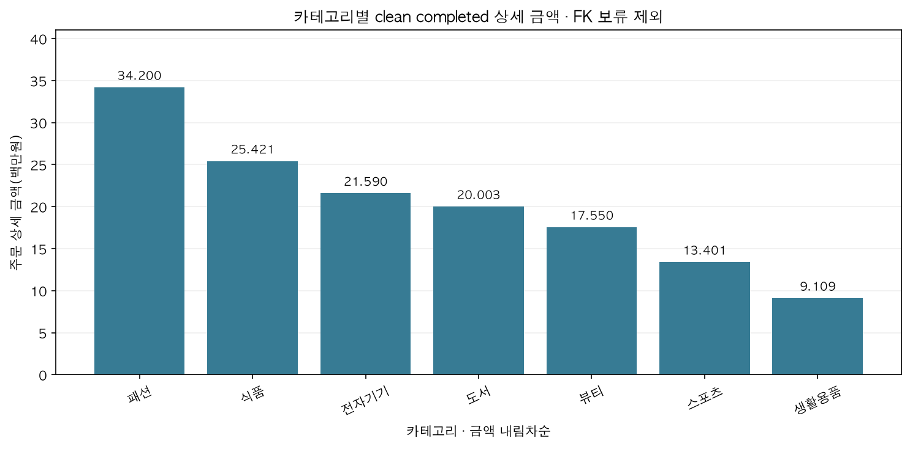
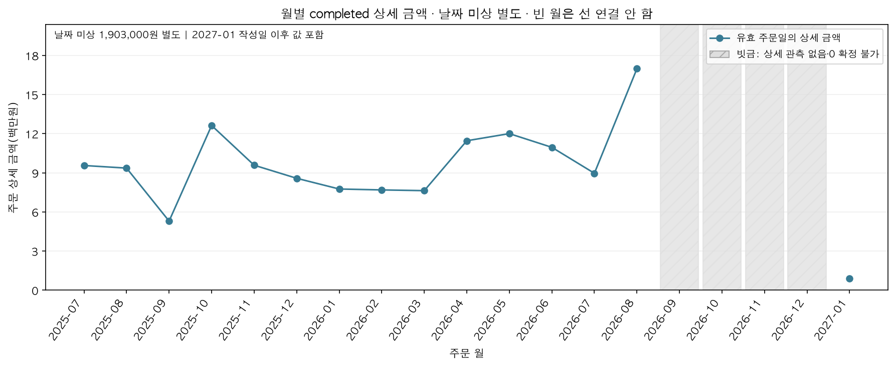
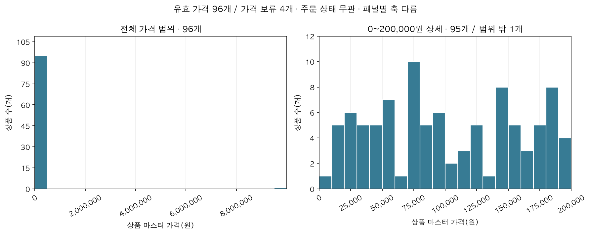

# Chapter07 시각화 결과와 품질 검증

## 범위와 보완 기준
Chapter05 전용 Raw를 보존하고 별도 clean을 생성함
수량은 전체 형식이 일치하는 정수+개 표기만 복구함
가격 오류는 상품 ID·카테고리와 분리하고 원본 FK 오류는 사유별 보류함
과거 Chapter05 제출본과 공유 processed는 변경하지 않음

## 금액과 행 수 대사
이전 completed 141,340,000원 + 복구 386,000원 - FK 보류 452,000원 = clean 141,274,000원
clean completed 상세 445행·고유 178주문
유효 날짜 139,371,000원 + 날짜 미상 1,903,000원

```text
                        check  value
                     raw_rows    765
normalized_duplicates_removed      2
           unique_source_rows    763
                   clean_rows    748
                    held_rows     15
           quantity_recovered      3
           recovered_retained      3
          product_master_rows    100
             price_valid_rows     96
              price_held_rows      4
          orders_to_customers      0
              items_to_orders      0
            items_to_products      0
```

## 보류 사유
사유 조합별 행 수로 집계하여 중복 계산하지 않음
known_amount에는 비양수가 포함될 수 있으며 amount_unknown은 계산 불가 건수임 정상 completed 금액과 단순 합산하지 않음

```text
                                    hold_reason  rows  known_amount  amount_unknown
                                   customer_fk;     3     1769000.0               0
                        customer_fk;product_fk;     1      290000.0               0
                                      order_fk;     2      922000.0               0
                                    product_fk;     1       76000.0               0
            quantity_unresolved_or_nonpositive;     4      -42000.0               2
quantity_unresolved_or_nonpositive;customer_fk;     1           0.0               0
          unit_price_unresolved_or_nonpositive;     3           0.0               2
```

## 핵심 결과와 한계
패션 34,200,000원·24.21%가 가장 큼 수익성·선호 원인은 알 수 없음
2026-08 16,980,000원이 관측 월 최대이며 빈 월은 0으로 단정하지 않음
상품 100개 중 가격 유효 96개와 보류 4개를 구분함 9,999,999원 극단값은 확인 없이 삭제하지 않음
날짜 미상·2027-01 작성일 이후 값과 원본 보류 거래의 업무상 의미는 미해결임
가격 불명 4개 상품의 관계·카테고리는 보존하며 해당 completed 3,939,000원은 금액 분석에 포함함





## 검증
```text
                       검증    expected      actual  passed
                  카테고리 합계 141274000.0 141274000.0    True
               월별+날짜미상 합계 141274000.0 141274000.0    True
                    상품 합계 141274000.0 141274000.0    True
                    고객 합계 141274000.0 141274000.0    True
                 주문 상태 건수       300.0       300.0    True
clean orders_to_customers         0.0         0.0    True
    clean items_to_orders         0.0         0.0    True
  clean items_to_products         0.0         0.0    True
              기존+복구-보류 대사 141274000.0 141274000.0    True
```
CSV 독립 계산과 실제 그래프 좌표·구간 검증 PASS
대표 그래프를 포함한 6개 PNG 재생성 SHA-256 일치
원본 Raw SHA-256 보존

## 결과 파일
[카테고리](ch07_category.csv) · [월별](ch07_monthly.csv) · [월 관측 범위](ch07_monthly_coverage.csv)
[전체 가격 구간](ch07_histogram.csv) · [확대 가격 구간](ch07_histogram_zoom.csv)
[전처리](ch07_processing_audit.csv) · [보류](ch07_hold_summary.csv) · [금액 대사](ch07_amount_reconciliation.csv)
[품질 범위](ch07_quality.csv) · [집계 검증](ch07_validation.csv) · [그래프 검증](ch07_graph_validation.csv)
식별자 포함 복구·보류 행 자료는 내부에만 보존함
