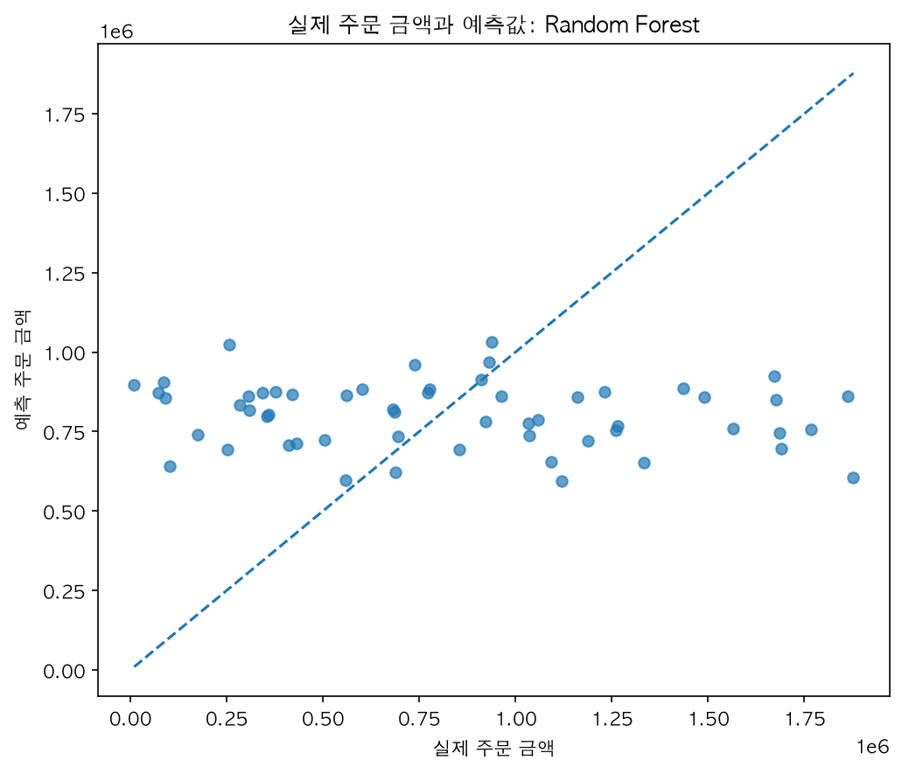
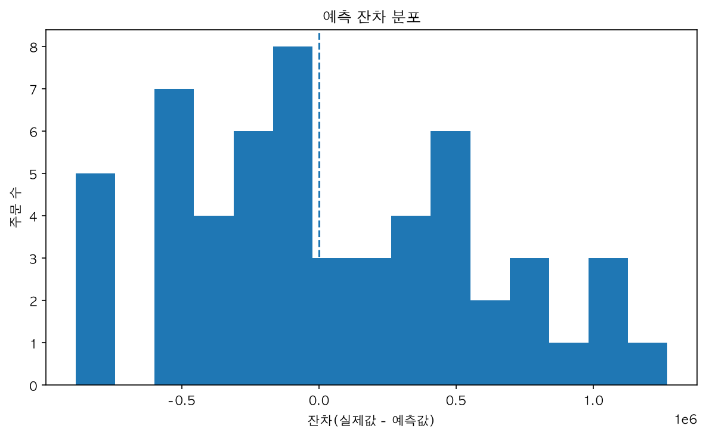

# Chapter 9 회귀 분석 요약 보고서

## 1. 분석 목적과 예측 시점
주문 상세 수량·단가·금액은 모델 입력에서 제외하고, 주문 시점 정보와 고객의 비식별 특성만으로 주문별 `order_total`을 추정합니다.

최초 실습은 Train CV 선택 후 Test를 평가함 현재는 이미 본 Test를 사용하는 수정 후 재현 평가이며 새 미사용 평가가 아님 날짜 그룹 CV로 경계를 수정했으며 성능을 높이기 위한 후보 또는 설정 탐색은 수행하지 않음

## 2. 모델링 데이터와 분할
- 전체 행 수: 300
- 예측 대상: order_total
- 입력값: order_month, order_dayofweek, age, payment_method, gender, city

```text
split  rows  ratio_pct start_date   end_date
train   244      81.33 2025-07-09 2026-04-13
 test    56      18.67 2026-04-14 2026-07-08
```

## 3. Feature Audit
```text
         column  selected            role                   reason
    order_month      True allowed_feature   교육용 예측 시점에 사용 가능하다고 가정
order_dayofweek      True allowed_feature   교육용 예측 시점에 사용 가능하다고 가정
            age      True allowed_feature   교육용 예측 시점에 사용 가능하다고 가정
 payment_method      True allowed_feature   교육용 예측 시점에 사용 가능하다고 가정
         gender      True allowed_feature   교육용 예측 시점에 사용 가능하다고 가정
           city      True allowed_feature   교육용 예측 시점에 사용 가능하다고 가정
 avg_unit_price     False       forbidden      주문 상세에서 만든 목표 대리 변수
    customer_id     False       forbidden                   고객 식별자
     item_count     False       forbidden  주문 상세가 확인된 뒤 계산되는 사후 집계
     line_total     False       forbidden       목표값을 구성하는 주문 상세 금액
       order_id     False       forbidden                   주문 식별자
   order_status     False       forbidden 예측 시점 이후에 확정될 수 있는 사후 정보
    order_total     False       forbidden                 예측 대상 자체
     product_id     False       forbidden  주문 상세가 확인되어야 알 수 있는 식별자
       quantity     False       forbidden                목표값 계산 재료
 total_quantity     False       forbidden      주문 상세에서 만든 목표 대리 변수
     unit_price     False       forbidden                목표값 계산 재료
```

## 4. 훈련 기간 후보 모델 비교
```text
            model  n_splits   cv_MAE_mean   cv_MAE_std  cv_R2_mean
    Baseline Mean         5 421924.135575 47631.459807   -0.025308
    Random Forest         5 431319.994133 24810.544240   -0.095117
Linear Regression         5 455325.127069 57645.538343   -0.294096
```

선택 모델: **Random Forest**

## 5. 최종 테스트 평가
```text
        model       selection_role     train_MAE      test_MAE     test_RMSE   test_R2  MAE_improvement_vs_baseline_pct
Baseline Mean             baseline 416266.191884 443449.648712 522189.699620 -0.001121                             0.00
Random Forest selected_by_train_cv 326438.478132 458819.917234 548190.446723 -0.103298                            -3.47
```

Random Forest의 최종 테스트 MAE가 베이스라인보다 개선되지 않았습니다.

## 6. 공개 가능한 오차 상위 10건
```text
order_date  actual_order_total  predicted_order_total      residual    abs_error         model
2026-06-15             1877000          605528.715709  1.271471e+06 1.271471e+06 Random Forest
2026-06-19             1767000          756889.654706  1.010110e+06 1.010110e+06 Random Forest
2026-05-27             1863000          861784.708271  1.001215e+06 1.001215e+06 Random Forest
2026-05-11             1690000          694946.179725  9.950538e+05 9.950538e+05 Random Forest
2026-05-23             1685000          745836.316118  9.391637e+05 9.391637e+05 Random Forest
2026-06-11               10000          897415.394314 -8.874154e+05 8.874154e+05 Random Forest
2026-05-23             1677000          849179.542426  8.278205e+05 8.278205e+05 Random Forest
2026-07-08               86000          904745.854532 -8.187459e+05 8.187459e+05 Random Forest
2026-04-24             1566000          758941.292777  8.070587e+05 8.070587e+05 Random Forest
2026-06-14               72000          871636.144070 -7.996361e+05 7.996361e+05 Random Forest
```

## 7. 자동 검증 Evidence
```text
                                    check value status
                forbidden_feature_overlap     0   PASS
                 strict_train_before_test  True   PASS
        selected_model_exists_in_train_cv  True   PASS
             final_test_contains_baseline  True   PASS
final_test_contains_frozen_selected_model  True   PASS
                         test_rows_for_r2    56   PASS
```

## 8. 사람 검토 체크리스트
```text
                               check_item                status                                                evidence_or_limit
                             예측 시점이 명확한가?               DEFINED                                   결제수단 선택 후 상세를 모델에 제공하기 전으로 정의함
             목표값과 목표값의 계산 재료를 입력에서 제외했는가?              VERIFIED                        공식 6개 Feature만 사용하고 금지 Feature 겹침 0개를 검사함
             예측 이후에 알 수 있는 정보를 사용하지 않았는가? ASSUMPTION_UNRESOLVED                      결제수단 및 고객 속성의 실제 기록 시각은 미확인이고 가입일 이전 주문이 있음
                식별자를 일반 숫자 변수로 사용하지 않았는가?              VERIFIED                  customer_id와 order_id는 관계 연결에만 사용하고 모델 입력에서 제외함
                 전처리기가 훈련 데이터 안에서만 학습되는가?     CURRENT_DATA_ONLY 현재 나이 결측 및 변환 실패 0건이라 사전 중앙값 대체는 발생하지 않음 다른 데이터의 누수 안전성을 보장하지 않음
        같은 날짜가 train과 test에 동시에 포함되지 않는가?              VERIFIED                     Final Test와 Train 날짜 분리 및 날짜 그룹 CV 5개 경계 검증함
후보 모델 선택을 훈련 기간 TimeSeriesSplit에서만 수행했는가?      CORRECTIVE_RERUN        현재 후보 선택 지표는 Train 날짜 그룹 CV임 기존 Test를 이미 본 수정 평가라는 한계가 있음
        모델 선택을 고정한 뒤 test를 최종 평가에만 사용했는가?           REUSED_TEST           최초 실습에서는 선택 후 평가했으나 현재는 같은 Test의 재현 평가이며 새로운 독립 평가가 아님
             DummyRegressor 베이스라인과 비교했는가?              VERIFIED                Final Test는 DummyRegressor와 고정 Random Forest만 비교함
               MAE, RMSE, R²를 올바르게 해석했는가?              VERIFIED                    Raw Decimal Target 및 직접 MAE, RMSE, R2 계산을 대조함
                  음수 R²와 낮은 성능을 숨기지 않았는가?           USE_ON_HOLD                      Baseline보다 나쁜 성능과 음수 R2를 공개하고 현재 사용 보류로 판단함
           식별자가 포함된 내부 결과를 외부에 공개하지 않았는가?  PUBLIC_SCOPE_CHECKED                    공개 목록의 컬럼을 검사하고 식별자 포함 내부 CSV는 공개 복사 대상에서 제외함
```

## 9. 해석 시 주의사항
- MAE와 RMSE는 주문 금액과 같은 단위로 해석합니다.
- R²는 음수가 될 수 있습니다.
- 낮은 성능을 감추기 위해 목표 계산 재료나 사후 정보를 feature로 추가하지 않습니다.
- 테스트 결과를 본 뒤 후보를 다시 고르면 Final Test 역할이 깨집니다.
- 모델을 운영하지 않는 결정도 올바른 분석 결과가 될 수 있습니다.


## 10. 현재 사용 판단 및 남은 한계

- 현재 데이터로는 사용 보류함
- Random Forest의 Test MAE 458,819.92원, RMSE 548,190.45원, R2 -0.1033, Baseline 대비 MAE 개선율 -3.47%임
- 금지 Feature 검사와 자동 Validation PASS는 고객 속성의 과거 시점 가용성 또는 운영 성능을 보장하지 않음
- 가입일 이전 주문의 업무상 의미와 실제 속성 기록 시각을 확인하지 못해 원본을 임의 수정하거나 삭제하지 않음
- 현재 나이 결측 및 숫자 변환 실패가 없어 준비 함수의 Pipeline 밖 중앙값 대체가 발생하지 않음 일반 데이터에 재사용할 때는 전처리를 다시 점검해야 함
- 날짜 그룹 CV 경계 수정은 완료했으나 기존 Test를 재사용했으므로 새 미래 데이터에서 독립 검증이 필요함

```text
 date_parse_failures  orders_before_signup  affected_customers  train_affected  test_affected                                            business_chronology
                   0                    56                  31              51              5 UNRESOLVED: confirm signup meaning / synthetic-data provenance
```

## 11. 그래프 및 공개 결과




- [ch09_regression_split_summary.csv](ch09_regression_split_summary.csv)
- [ch09_regression_feature_audit.csv](ch09_regression_feature_audit.csv)
- [ch09_regression_cv_summary.csv](ch09_regression_cv_summary.csv)
- [ch09_regression_model_comparison.csv](ch09_regression_model_comparison.csv)
- [ch09_regression_validation.csv](ch09_regression_validation.csv)
- [ch09_regression_checklist.csv](ch09_regression_checklist.csv)
- [ch09_business_temporal_checks.csv](ch09_business_temporal_checks.csv)
- [ch09_cv_folds.csv](ch09_cv_folds.csv)

원본 ID가 들어 있는 model_data_internal과 predictions_internal은 내부에만 보존함
