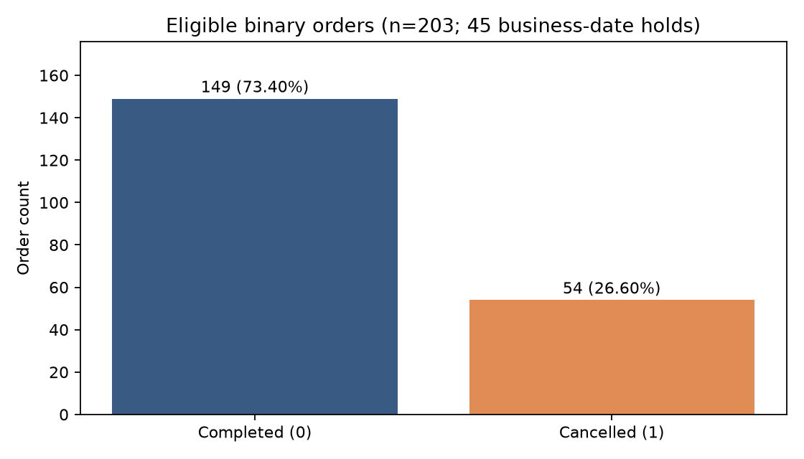
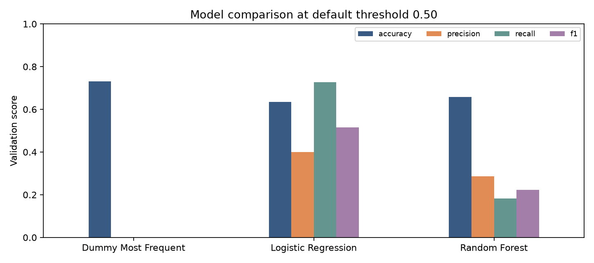
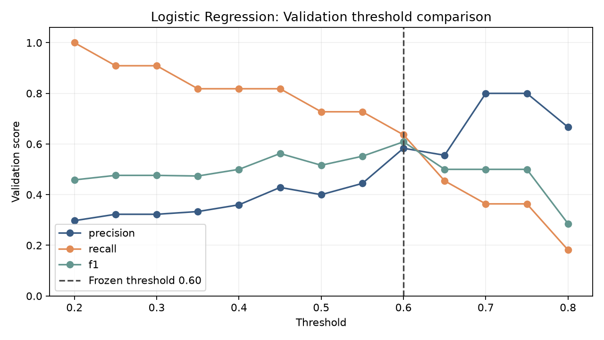
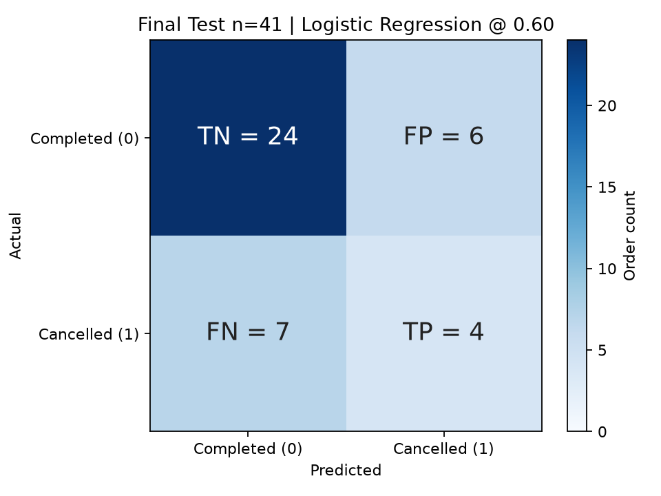

# Chapter 10 분류 분석 요약 보고서

## 1. 분석 목적과 타깃
완료 주문과 취소 주문만 사용해 주문 취소 여부를 예측합니다.

- completed = 0
- cancelled = 1
- refunded 및 기타 상태 = 모델링 범위 제외

## 2. 모델링 데이터
- 행 수: 203
- 예측 대상: is_cancelled

## 3. 타깃 클래스 분포
```text
 is_cancelled class_label  count  ratio
            0   completed    149  0.734
            1   cancelled     54  0.266
```

## 4. Feature Audit
```text
           column  selected            role                 reason
              age      True allowed_feature 교육용 예측 시점에 사용 가능하다고 가정
       item_count      True allowed_feature 교육용 예측 시점에 사용 가능하다고 가정
   total_quantity      True allowed_feature 교육용 예측 시점에 사용 가능하다고 가정
     order_amount      True allowed_feature 교육용 예측 시점에 사용 가능하다고 가정
      order_month      True allowed_feature 교육용 예측 시점에 사용 가능하다고 가정
  order_dayofweek      True allowed_feature 교육용 예측 시점에 사용 가능하다고 가정
days_since_signup      True allowed_feature 교육용 예측 시점에 사용 가능하다고 가정
           gender      True allowed_feature 교육용 예측 시점에 사용 가능하다고 가정
             city      True allowed_feature 교육용 예측 시점에 사용 가능하다고 가정
   payment_method      True allowed_feature 교육용 예측 시점에 사용 가능하다고 가정
    cancel_reason     False       forbidden       취소 이후 생성되는 사후 정보
     cancelled_at     False       forbidden       취소 이후 생성되는 사후 정보
      customer_id     False       forbidden                 고객 식별자
     is_cancelled     False       forbidden               예측 대상 자체
         order_id     False       forbidden                 주문 식별자
     order_status     False       forbidden   예측 결과와 직접 연결되는 주문 상태
       product_id     False       forbidden            주문 상세 식별 정보
```

## 5. 병합 검증
```text
                         merge  before_rows  after_rows  row_count_preserved  unmatched_count status validate_relationship
order_id → order_item_features          203         203                 True                0   PASS            one_to_one
       customer_id → customers          203         203                 True                0   PASS           many_to_one
```

## 6. Train / Validation / Test
```text
     split  is_cancelled class_label  count  ratio
     train             0   completed     89 0.7355
     train             1   cancelled     32 0.2645
validation             0   completed     30 0.7317
validation             1   cancelled     11 0.2683
      test             0   completed     30 0.7317
      test             1   cancelled     11 0.2683
```

## 7. Validation 모델 비교
```text
              model evaluation_split  accuracy  precision   recall       f1
Logistic Regression       validation  0.634146   0.400000 0.727273 0.516129
      Random Forest       validation  0.658537   0.285714 0.181818 0.222222
Dummy Most Frequent       validation  0.731707   0.000000 0.000000 0.000000
```

선택 모델: **Logistic Regression**

## 8. Validation Threshold 비교
```text
 threshold  accuracy  precision   recall       f1
      0.20  0.365854   0.297297 1.000000 0.458333
      0.25  0.463415   0.322581 0.909091 0.476190
      0.30  0.463415   0.322581 0.909091 0.476190
      0.35  0.512195   0.333333 0.818182 0.473684
      0.40  0.560976   0.360000 0.818182 0.500000
      0.45  0.658537   0.428571 0.818182 0.562500
      0.50  0.634146   0.400000 0.727273 0.516129
      0.55  0.682927   0.444444 0.727273 0.551724
      0.60  0.780488   0.583333 0.636364 0.608696
      0.65  0.756098   0.555556 0.454545 0.500000
      0.70  0.804878   0.800000 0.363636 0.500000
      0.75  0.804878   0.800000 0.363636 0.500000
      0.80  0.756098   0.666667 0.181818 0.285714
```

선택 threshold: **0.60**

## 9. Final Test
```text
              model evaluation_split  threshold   selection_status  accuracy  precision   recall       f1
Logistic Regression       test_final        0.6 frozen_before_test  0.682927        0.4 0.363636 0.380952
```

## 10. Confusion Matrix
```text
                  pred_completed  pred_cancelled
actual_completed              24               6
actual_cancelled               7               4
```

## 11. 자동 Validation Evidence
```text
                               check                                        value          status
  target_exactly_completed_cancelled                                       [0, 1]            PASS
           forbidden_feature_overlap                                            0            PASS
              merge_rows_and_matches                                         True            PASS
        all_splits_have_both_classes                                         True            PASS
        model_selected_on_validation                                         True            PASS
    threshold_selected_on_validation                                         True            PASS
public_prediction_identifier_columns                                         none            PASS
       test_used_as_final_evaluation                                         True            PASS
            manual_confusion_metrics                                         True            PASS
   probability_threshold_coordinates                                         True            PASS
              disjoint_split_indices                                         True            PASS
   freeze_event_precedes_single_test                                         True            PASS
             source_scope_reconciles                                         True            PASS
       pipeline_train_fit_parameters                                         True            PASS
    business_date_meaning_unresolved                                           45 REVIEW_REQUIRED
prediction_time_feature_availability assumption, historical snapshots unavailable REVIEW_REQUIRED
```

## 12. 사람 검토 체크리스트
```text
                                        check_item                                              status                                         review_scope
           completed와 cancelled만 사용해 이진 타깃을 만들었는가?                                       code_verified automated evidence; student final review is separate
                 refunded 등 다른 상태를 0 클래스에 섞지 않았는가?                                       code_verified automated evidence; student final review is separate
                 예측 시점과 feature 가용성 가정을 설명할 수 있는가?       documented_assumption_unconfirmed_in_business automated evidence; student final review is separate
        line_total = quantity × unit_price를 검증했는가?                                       code_verified automated evidence; student final review is separate
                 병합에 validate를 사용하고 미매칭 0건을 확인했는가?                                       code_verified automated evidence; student final review is separate
 order_status, target, ID, 사후 정보를 feature에서 제외했는가?                                       code_verified automated evidence; student final review is separate
                   train, validation, test를 분리했는가?                                       code_verified automated evidence; student final review is separate
                모델과 threshold는 validation에서 선택했는가?                                       code_verified automated evidence; student final review is separate
            모델과 threshold를 고정한 뒤 test를 한 번만 사용했는가? frozen_first_evaluation_then_reproducibility_replay automated evidence; student final review is separate
                               Dummy 기준 모델과 비교했는가?                                       code_verified automated evidence; student final review is separate
accuracy 외 precision, recall, F1과 FP/FN을 함께 확인했는가?                                       code_verified automated evidence; student final review is separate
      공개 prediction에서 내부 source index와 식별자를 제거했는가?                                       code_verified automated evidence; student final review is separate
                      random split의 교육용 한계를 기록했는가?                               limitation_documented automated evidence; student final review is separate
                         모델 결과를 취소 원인으로 단정하지 않았는가?                               limitation_documented automated evidence; student final review is separate
```

## 13. 해석 시 주의사항
- 모델과 threshold는 Validation에서 선택했습니다.
- Final Test는 선택이 끝난 뒤 마지막 평가에만 사용했습니다.
- accuracy뿐 아니라 precision, recall, F1과 FP/FN을 함께 봅니다.
- random split은 교육용 설계이며 실제 운영 전에는 out-of-time 평가가 필요합니다.
- 모델이 학습한 예측 패턴을 취소의 원인으로 단정하지 않습니다.
- 공개 prediction에는 내부 source index나 원본 식별자를 포함하지 않습니다.

## 14. 분석 범위와 남은 데이터 문제

- 원본 300주문 = 분석 203 + 업무 날짜 보류 45 + refunded 제외 52로 대사함
- 가입일 이전 주문은 전체 상태 56건이며 이진 대상에서는 completed 35건과 cancelled 10건을 보류함
- 변환 실패는 0건이며 보류가 날짜의 업무 의미를 해결한 것은 아님
- 공식 음수 days_since_signup Gate는 203건 분석 subset에서 충족하며 원본 문제 45건은 별도 미해결임
- 날짜 보류는 모델 성능을 보기 전에 정한 적격 기준이며 보류 제외로 선택편향이 생길 수 있음

```text
             scope order_status  order_count  customer_count  detail_rows  total_quantity  order_amount
          eligible    cancelled           54              44          136           427.0    52759000.0
          eligible    completed          149              84          385          1178.0   123886000.0
business_date_hold    cancelled           10              10           26            80.0     9422000.0
business_date_hold    completed           35              23           89           264.0    25104000.0
   target_excluded     refunded           52              46          128           384.0    44439000.0
```

## 15. 예측 시점과 사전 선택 규칙

- 상세와 결제수단이 확정됐지만 최종 취소 여부가 확정되기 전을 예측 시점으로 가정함
- item_count는 상세 행 수이고 total_quantity 및 order_amount는 이 시점에 확정된 quantity와 unit_price로만 계산해야 함
- 고객 정보와 signup_date가 당시 가용하며 age가 해당 시점 나이라고 가정함, 생년월일과 시점별 스냅샷이 없어 정밀 확인은 불가함
- 선택 기준은 비Dummy Validation F1, Recall, Precision, 모델명 순이며 threshold는 0.20~0.80에서 0.05 간격으로 비교하고 F1, Recall, Precision, 낮은 값 순으로 선택함
- FP/FN 비용은 미확정이라 교육용 F1 기준을 사용함
- 최초 Test 전에 선택과 입력 및 split 해시를 저장함, 이후 Notebook 및 CLI 재실행은 고정 결과 재현이며 새로운 독립 Test가 아님

## 16. 오류 해석과 사용 판단

- TN 24, FP 6, FN 7, TP 4이며 FP는 완료 주문을 취소로 오탐한 경우이고 FN은 실제 취소를 놓친 경우임
- 선택 threshold의 Validation F1 0.608696에서 Test F1 0.380952로 -0.227743 변함
- split별 표본 구성과 적은 취소 표본이 차이에 영향을 줄 수 있으나 이 결과만으로 차이의 원인을 확정할 수 없음
- 예측 확률의 보정 여부가 검증되지 않았으므로 확률을 정확한 취소 위험률로 해석하지 않음
- 자동 검증의 PASS는 계산 및 선택 절차에 한정함, 날짜 의미와 시점별 Feature 가용성은 REVIEW_REQUIRED로 남김
- 현재 운영 사용 보류, 시간순 평가와 고객 중복 영향, 공정성, 비용 기준 및 날짜 의미 확인이 필요함
- 확인한 결과는 보류 제외 표본의 예측 성능이며 주문 금액이나 고객 특성이 취소를 일으킨다는 인과 주장은 불가함

## 17. 공개 산출물

- [ch10_classification_checklist.csv](ch10_classification_checklist.csv)
- [ch10_classification_predictions.csv](ch10_classification_predictions.csv)
- [ch10_classification_report.csv](ch10_classification_report.csv)
- [ch10_classification_validation.csv](ch10_classification_validation.csv)
- [ch10_confusion_matrix.csv](ch10_confusion_matrix.csv)
- [ch10_data_quality_checks.csv](ch10_data_quality_checks.csv)
- [ch10_error_analysis.csv](ch10_error_analysis.csv)
- [ch10_evaluation_trace.csv](ch10_evaluation_trace.csv)
- [ch10_feature_audit.csv](ch10_feature_audit.csv)
- [ch10_merge_checks.csv](ch10_merge_checks.csv)
- [ch10_pipeline_fit_audit.csv](ch10_pipeline_fit_audit.csv)
- [ch10_scope_audit.csv](ch10_scope_audit.csv)
- [ch10_selection_summary.csv](ch10_selection_summary.csv)
- [ch10_split_summary.csv](ch10_split_summary.csv)
- [ch10_target_distribution.csv](ch10_target_distribution.csv)
- [ch10_test_metrics.csv](ch10_test_metrics.csv)
- [ch10_validation_model_comparison.csv](ch10_validation_model_comparison.csv)
- [ch10_validation_threshold_metrics.csv](ch10_validation_threshold_metrics.csv)








